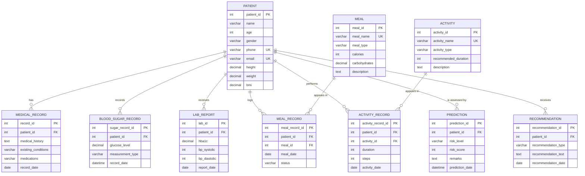

# ER Diagram & Relational Schema

## Entity–Relationship Diagram (Mermaid)

## Relational Schema (PK underlined → shown in **bold**, FK in *italics*)

| Relation | Attributes |
|---|---|
| patient | **patient_id**, name, age, gender, phone, email, height, weight, bmi, created_at |
| medical_record | **record_id**, *patient_id*, medical_history, existing_conditions, medications, record_date |
| blood_sugar_record | **sugar_record_id**, *patient_id*, glucose_level, measurement_type, record_date |
| lab_report | **lab_id**, *patient_id*, hba1c, bp_systolic, bp_diastolic, report_date |
| meal | **meal_id**, meal_name, meal_type, calories, carbohydrates, description |
| meal_record | **meal_record_id**, *patient_id*, *meal_id*, meal_date, status |
| activity | **activity_id**, activity_name, activity_type, recommended_duration, description |
| activity_record | **activity_record_id**, *patient_id*, *activity_id*, duration, steps, activity_date |
| prediction | **prediction_id**, *patient_id*, risk_level, risk_score, remarks, prediction_date |
| recommendation | **recommendation_id**, *patient_id*, recommendation_type, recommendation_text, recommendation_date |

## Foreign-key relationships

| Child table.column | → Parent table.column | ON DELETE |
|---|---|---|
| medical_record.patient_id | patient.patient_id | CASCADE |
| blood_sugar_record.patient_id | patient.patient_id | CASCADE |
| lab_report.patient_id | patient.patient_id | CASCADE |
| meal_record.patient_id | patient.patient_id | CASCADE |
| meal_record.meal_id | meal.meal_id | RESTRICT |
| activity_record.patient_id | patient.patient_id | CASCADE |
| activity_record.activity_id | activity.activity_id | RESTRICT |
| prediction.patient_id | patient.patient_id | CASCADE |
| recommendation.patient_id | patient.patient_id | CASCADE |

## Normalisation notes

* **1NF** – every attribute is atomic (blood pressure split into `bp_systolic` / `bp_diastolic`; no repeating groups: each reading, meal or activity is its own row).
* **2NF** – all tables use a single-column surrogate primary key, so no partial dependencies exist.
* **3NF** – no transitive dependencies: meal attributes (calories, carbohydrates) live only in `meal`, activity attributes only in `activity`; the association tables store just the FK plus facts about the event (date, status, duration, steps). `bmi` is a derived attribute retained deliberately for reporting and kept consistent by application logic / trigger.
